# Steam Medallion Architecture

An automated, idempotent data pipeline that collects daily Steam game statistics from the [SteamSpy API](https://steamspy.com/api.php) and processes them through a **Bronze, Silver and Gold** medallion architecture on Databricks (Delta Lake / PySpark). The Gold layer is a star schema that feeds a Power BI dashboard. A GitHub Actions workflow fetches the data every day and triggers the Databricks pipeline job, which refreshes all three layers.

Built as a pair project for a Data Analysis and Visualization course. **Current status: Phase 3 complete** (Bronze, Silver, Gold and the Power BI dashboard).

## Contents

1. [Project Overview](#project-overview)
2. [Architecture](#architecture)
3. [Engineering Highlights](#engineering-highlights)
4. [Data Models](#data-models)
5. [Gold Layer: Dimensional Model](#gold-layer-dimensional-model)
6. [Power BI Dashboard](#power-bi-dashboard)
7. [Repository Structure](#repository-structure)
8. [Setup](#setup)
9. [Execution Guide](#execution-guide)
10. [Testing Schema Drift](#testing-schema-drift)
11. [Test Results](#test-results)
12. [Notes and Limitations](#notes-and-limitations)
13. [Team](#team)

## Project Overview

The project treats Steam, the largest PC game distribution platform, as a live market and tracks how games perform over time in pricing, player engagement, review sentiment and publisher presence. The insights are aimed at game publishers, investors and market analysts.

- **Source:** SteamSpy Public API (`https://steamspy.com/api.php?request=all&page={n}`). It returns paginated JSON of up to 1,000 games per page and needs no API key. Pages can overlap, so the same game may appear on more than one page.
- **Refresh cycle:** SteamSpy refreshes its aggregates about once a day, which suits a daily incremental pipeline.
- **PII:** none. Every field is a public, market-level statistic (game ID and name, studio names, aggregate review counts, ownership ranges, store prices, concurrent users). No individual user is identified, so no masking or hashing is needed. Silver only removes inactive entries (0 reviews and 0 concurrent users) as a data quality step.

## Architecture

```
GitHub Actions (daily, 22:00 UTC)
        |
        |  scripts/fetch_steamspy.py  ->  steamspy_<date>.jsonl
        v
Databricks Volume  (/Volumes/workspace/default/steam)
        |
        |  triggers Databricks job steam_daily_pipeline (load_type=incremental, date=<date>)
        v
Task 1: 02_raw_to_bronze    -> bronze_steam
Task 2: 03_bronze_to_silver -> silver_steam, silver_steam_history  (+ silver_quarantine)
Task 3: 10_silver_to_gold   -> Gold star schema (workspace.gold)
        |
        v
Power BI (Import mode, through the Databricks SQL warehouse)

Every step also writes to pipeline_execution_logs.
Schema changes are recorded in schema_drift_log.
```

The scheduled job runs notebooks 02, 03 and 10 directly as three tasks, each depending on the one before. `04_pipeline_runner` runs 02 and 03 in order and is used for manual runs from the workspace.

Bronze and Silver tables live in the `workspace.steam` schema. Gold tables live in `workspace.gold`.

**Tech stack:** Databricks (Unity Catalog, Volumes, Jobs, SQL warehouse), Delta Lake, PySpark, Python 3.11 (`requests`), GitHub Actions, Power BI Desktop, SteamSpy API.

## Engineering Highlights

| Requirement | How it is implemented |
|-------------|-----------------------|
| Explicit schema-on-read | Raw files are read with a `StructType` / `StructField` schema. `inferSchema` is never used. Bronze reads every source column as `STRING`. |
| Strict casting | Casting happens in Bronze to Silver with `try_cast`. A failed cast gives `NULL` instead of an error. |
| `load_timestamp` everywhere | Present in every Bronze, Silver, quarantine and drift-log record. |
| Idempotency | Bronze uses `MERGE` on (`appid`, `load_date`). Silver uses `MERGE` on `appid`. Re-running the same date inserts no duplicates and updates only rows whose `row_hash` changed. |
| Incremental detection | Each row gets a SHA-256 `row_hash` over the 17 source columns. On incremental loads, only new appids or rows whose hash differs from the latest earlier Bronze hash are kept. |
| Parameterized backfills | Notebooks take `load_type`, `date`, `landing_path` and `batch_id` as widget parameters. No date is hardcoded. The default landing folder (`/Volumes/workspace/default/steam`) is a constant in `02_raw_to_bronze`, and `landing_path` overrides it for any single run. |
| Schema drift | New columns are detected, added to Bronze with `MERGE WITH SCHEMA EVOLUTION` and logged in `schema_drift_log`. Wrong-typed values are sent to `silver_quarantine`, so the batch does not crash. |
| Audit logging | Every layer and every run writes a row to `pipeline_execution_logs`, including failures with the error message. Gold runs are logged as `Silver-to-Gold` with rows inserted and updated across all Gold tables. |
| Dimensional model | Gold is a star schema with three business facts, one audit fact and eight dimensions, refreshed automatically after Silver. |
| Read performance | Gold facts and `silver_steam_history` use Liquid Clustering (`CLUSTER BY`) on their date and game keys. |

## Data Models

Delta tables do not enforce primary keys, so the keys below are **logical keys** that the `MERGE` statements rely on.

### Bronze: `bronze_steam`

Raw SteamSpy data stored as strings, plus load metadata. It keeps history: one row per game per load date on which that game was new or changed. Duplicate appids inside one landing file are removed before loading.

**Primary key:** (`appid`, `load_date`)

| Column | Type | Description |
|--------|------|-------------|
| `appid` | STRING | Steam application ID |
| `name` | STRING | Game name |
| `developer` | STRING | Developer name(s) |
| `publisher` | STRING | Publisher name(s) |
| `score_rank` | STRING | SteamSpy score rank |
| `userscore` | STRING | User score |
| `positive` | STRING | Positive review count |
| `negative` | STRING | Negative review count |
| `owners` | STRING | Estimated owner range, e.g. `"1,000,000 .. 2,000,000"` |
| `average_forever` | STRING | Average playtime, all time (minutes) |
| `average_2weeks` | STRING | Average playtime, last 2 weeks (minutes) |
| `median_forever` | STRING | Median playtime, all time (minutes) |
| `median_2weeks` | STRING | Median playtime, last 2 weeks (minutes) |
| `price` | STRING | Current price in US cents |
| `initialprice` | STRING | Launch price in US cents |
| `discount` | STRING | Current discount percentage |
| `ccu` | STRING | Concurrent users (peak, yesterday) |
| `source_file` | STRING | Landing file the row came from |
| `batch_id` | STRING | UUID of the Raw-to-Bronze run |
| `load_type` | STRING | `full` or `incremental` |
| `load_date` | DATE | Date of the data being loaded |
| `row_hash` | STRING | SHA-256 of the 17 source columns, used for change detection |
| `load_timestamp` | TIMESTAMP | When the record was ingested |

New columns that appear in the source are added to this table automatically (schema evolution). They are not part of `row_hash`.

### Silver: `silver_steam`

Typed, cleaned, current-state view: exactly one row per game. All 17 source fields are cast to proper types.

**Primary key:** `appid`

| Column | Type | Description / transformation |
|--------|------|------------------------------|
| `appid` | INT | Cast from string |
| `name` | STRING | Trimmed, empty string becomes `NULL` |
| `developer` | STRING | Trimmed, empty string becomes `NULL` |
| `publisher` | STRING | Trimmed, empty string becomes `NULL` |
| `positive` | INT | Cast from string |
| `negative` | INT | Cast from string |
| `total_reviews` | INT | `positive + negative` |
| `approval_rate` | DOUBLE | `positive / total_reviews`, a ratio from 0 to 1 (`NULL` if no reviews) |
| `ccu` | INT | Cast from string |
| `owners_min` | BIGINT | Lower bound parsed from the `owners` range |
| `owners_max` | BIGINT | Upper bound parsed from the `owners` range |
| `price_usd` | DOUBLE | `price / 100` (cents to dollars) |
| `initialprice_usd` | DOUBLE | `initialprice / 100` |
| `discount_pct` | DOUBLE | Cast from string |
| `is_free` | BOOLEAN | `price_usd = 0` |
| `score_rank` | INT | Cast from string. Blank in the source for almost every game, so usually `NULL` |
| `userscore` | INT | Cast from string. 0 for almost every game in the source |
| `average_forever_min` | INT | Average playtime since release, in minutes. Cast from `average_forever` |
| `average_2weeks_min` | INT | Average playtime in the last two weeks, in minutes. Cast from `average_2weeks` |
| `median_forever_min` | INT | Median playtime since release, in minutes. Cast from `median_forever` |
| `median_2weeks_min` | INT | Median playtime in the last two weeks, in minutes. Cast from `median_2weeks` |
| `row_hash` | STRING | Carried over from Bronze |
| `first_load_date` | DATE | Date the game first appeared in Silver |
| `last_load_date` | DATE | Date the game's data was last updated |
| `load_timestamp` | TIMESTAMP | When the record was last processed |

**Cleaning rules:**
- Rows that fail a cast or validation (invalid `appid`, uncastable numeric fields, unparsable `owners`) go to `silver_quarantine`.
- Dead entries with 0 reviews and 0 concurrent users are dropped. They are not quarantined and not counted in any log column.
- Only one row per `appid` is kept per run (the most recent).
- Blank values (such as an empty `score_rank`) become `NULL` and are not treated as failed casts.
- Update guard: an existing Silver row is updated only if its `row_hash` changed **and** the incoming `load_date` is not older than the stored `last_load_date`. Backfilling an old date therefore never overwrites newer data.

### Silver history: `silver_steam_history`

Same typed and cleaned columns as `silver_steam` (from `appid` to `row_hash`), plus `load_date` and `load_timestamp`. It keeps one row per game per date on which the game was new or changed, so the state of the market on any past day can be rebuilt from Silver. Gold reads its daily facts from this table.

**Primary key:** (`appid`, `load_date`). **Clustered by:** `load_date`, `appid`.

It is written by `03_bronze_to_silver` with a `MERGE` on (`appid`, `load_date`), in the same run that updates `silver_steam`.

### Supporting tables

**`silver_quarantine`** has the 17 source columns above (as `STRING`) plus the following. **Logical key:** (`appid`, `load_date`, `reject_reason`).

| Column | Type | Description |
|--------|------|-------------|
| `reject_reason` | STRING | Every failed check for the row, separated by `; ` |
| `load_date` | DATE | Date of the batch |
| `load_timestamp` | TIMESTAMP | When the row was quarantined |

**`schema_drift_log`**

| Column | Type | Description |
|--------|------|-------------|
| `column_name` | STRING | Column that appeared in the source |
| `drift_type` | STRING | Currently `new_column` |
| `detected_on` | DATE | Date of the load that revealed it |
| `source_file` | STRING | File it appeared in |
| `load_timestamp` | TIMESTAMP | When it was logged |

**`pipeline_execution_logs`**

Each log row gets its own unique `run_id`. The runner's row is not linked to the step rows by ID; match them by `start_time` and `end_time`.

| Column | Type | Description |
|--------|------|-------------|
| `run_id` | STRING | Unique ID of this log entry |
| `layer` | STRING | `Raw-to-Bronze`, `Bronze-to-Silver`, `Silver-to-Gold` or `Pipeline-Runner` |
| `load_type` | STRING | `full` / `incremental` |
| `file_processed` | STRING | What was processed: the landing file path (Raw-to-Bronze), `bronze_steam load_date=<date>` (Bronze-to-Silver), `gold date=<date>` (Silver-to-Gold) or `date=<date>` (Pipeline-Runner) |
| `batch_id` | STRING | Bronze batch ID |
| `start_time` | TIMESTAMP | Execution start |
| `end_time` | TIMESTAMP | Execution end |
| `status` | STRING | `Success` or `Failure` |
| `rows_inserted` | BIGINT | Rows inserted |
| `rows_updated` | BIGINT | Rows updated |
| `rows_skipped_unchanged` | BIGINT | Rows skipped because nothing changed |
| `rows_quarantined` | BIGINT | Rows sent to quarantine |
| `error_message` | STRING | Error text on failure |

The Pipeline-Runner row carries no row counts; those are on each step's own row. It is written only when `04_pipeline_runner` is used. Scheduled job runs write one row per step.

## Gold Layer: Dimensional Model

The Gold layer lives in the `workspace.gold` schema. It is built from Silver (`silver_steam` and `silver_steam_history`) by `10_silver_to_gold`, which runs as the third task of the daily job. All tables are Delta tables, and every load uses `MERGE`, so re-running a date changes nothing.

The model has two parts:

- **Business star schema:** three fact tables that share conformed dimensions (date, game, publisher, developer). One filter on a shared dimension slices every fact at once.
- **Audit mart:** `fact_pipeline_run` with `dim_date` and `dim_pipeline_layer`, used for the pipeline health page.

Delta tables do not enforce keys, so the keys below are logical keys that the `MERGE` statements and the Power BI relationships rely on.

### ER diagram

```mermaid
erDiagram
    dim_date ||--o{ fact_game_daily_snapshot : "date_key"
    dim_game ||--o{ fact_game_daily_snapshot : "game_key"
    dim_publisher ||--o{ fact_game_daily_snapshot : "publisher_key"
    dim_developer ||--o{ fact_game_daily_snapshot : "developer_key"
    dim_price_tier ||--o{ fact_game_daily_snapshot : "price_tier_key"
    dim_owners_band ||--o{ fact_game_daily_snapshot : "owners_band_key"

    dim_date ||--o{ fact_price_change : "date_key"
    dim_game ||--o{ fact_price_change : "game_key"
    dim_publisher ||--o{ fact_price_change : "publisher_key"
    dim_developer ||--o{ fact_price_change : "developer_key"
    dim_change_type ||--o{ fact_price_change : "change_type_key"

    dim_date ||--o{ fact_game_listing : "date_key"
    dim_game ||--o{ fact_game_listing : "game_key"
    dim_publisher ||--o{ fact_game_listing : "publisher_key"
    dim_developer ||--o{ fact_game_listing : "developer_key"
    dim_price_tier ||--o{ fact_game_listing : "price_tier_key"
    dim_owners_band ||--o{ fact_game_listing : "owners_band_key"

    dim_date ||--o{ fact_pipeline_run : "date_key"
    dim_pipeline_layer ||--o{ fact_pipeline_run : "layer_key"

    fact_game_daily_snapshot {
        int date_key FK
        int game_key FK
        bigint publisher_key FK
        bigint developer_key FK
        int price_tier_key FK
        int owners_band_key FK
        double price_usd
        double discount_pct
        boolean is_on_sale
        int total_reviews
        double approval_rate
        bigint owners_mid
    }
    fact_price_change {
        int date_key FK
        int game_key FK
        bigint publisher_key FK
        bigint developer_key FK
        int change_type_key FK
        double old_price_usd
        double new_price_usd
        double new_discount_pct
    }
    fact_game_listing {
        int date_key FK
        int game_key FK
        bigint publisher_key FK
        bigint developer_key FK
        int price_tier_key FK
        int owners_band_key FK
    }
    fact_pipeline_run {
        string run_id PK
        int date_key FK
        int layer_key FK
        string status
        double duration_seconds
        bigint rows_inserted
    }
    dim_date {
        int date_key PK
        date full_date
    }
    dim_game {
        int game_key PK
        string game_name
    }
    dim_publisher {
        bigint publisher_key PK
        string publisher_name
    }
    dim_developer {
        bigint developer_key PK
        string developer_name
    }
    dim_price_tier {
        int price_tier_key PK
        string tier_name
    }
    dim_owners_band {
        int owners_band_key PK
        string band_label
    }
    dim_change_type {
        int change_type_key PK
        string change_type
    }
    dim_pipeline_layer {
        int layer_key PK
        string layer_name
    }
```



### Fact tables

#### fact_game_daily_snapshot (periodic snapshot)

**Grain:** one row per game per loaded day, holding the game's state on that day.
**Primary key:** (`date_key`, `game_key`)
**Built from:** each game's latest `silver_steam_history` row on or before the date.

| Column | Type | Key / measure | Description |
|---|---|---|---|
| date_key | INT | FK to dim_date | Day of the snapshot (yyyymmdd) |
| game_key | INT | FK to dim_game | The game |
| publisher_key | BIGINT | FK to dim_publisher | First listed publisher |
| developer_key | BIGINT | FK to dim_developer | First listed developer |
| price_tier_key | INT | FK to dim_price_tier | Tier of the list price |
| owners_band_key | INT | FK to dim_owners_band | Estimated ownership range |
| price_usd | DOUBLE | Measure (non-additive) | Current price in US dollars |
| initialprice_usd | DOUBLE | Measure (non-additive) | List price in US dollars |
| discount_pct | DOUBLE | Measure (non-additive) | Current discount in percent |
| is_on_sale | BOOLEAN | Measure (additive as 0/1) | True when discount is above 0 |
| positive | INT | Measure (semi-additive) | Positive reviews |
| negative | INT | Measure (semi-additive) | Negative reviews |
| total_reviews | INT | Measure (semi-additive) | positive + negative |
| approval_rate | DOUBLE | Measure (non-additive) | positive / total_reviews |
| ccu | INT | Measure (semi-additive) | Peak concurrent users |
| owners_min | BIGINT | Measure (semi-additive) | Lower bound of estimated owners |
| owners_max | BIGINT | Measure (semi-additive) | Upper bound of estimated owners |
| owners_mid | BIGINT | Measure (semi-additive) | Midpoint of the owners range |
| load_timestamp | TIMESTAMP | Metadata | When the row was written |

Semi-additive measures can be summed across games but not across days, so the Power BI measures always use the latest day in the selected range.

#### fact_price_change (transaction)

**Grain:** one row per game per day on which its price or discount changed.
**Primary key:** (`date_key`, `game_key`)
**Built from:** each game's `silver_steam_history` row for the date compared with its previous row.

| Column | Type | Key / measure | Description |
|---|---|---|---|
| date_key | INT | FK to dim_date | Day of the change |
| game_key | INT | FK to dim_game | The game |
| publisher_key | BIGINT | FK to dim_publisher | First listed publisher |
| developer_key | BIGINT | FK to dim_developer | First listed developer |
| change_type_key | INT | FK to dim_change_type | Kind of change |
| old_price_usd | DOUBLE | Measure | Price before the change |
| new_price_usd | DOUBLE | Measure | Price after the change |
| price_change_usd | DOUBLE | Measure (additive) | new_price_usd minus old_price_usd |
| old_discount_pct | DOUBLE | Measure | Discount before the change |
| new_discount_pct | DOUBLE | Measure | Discount after the change |
| old_initialprice_usd | DOUBLE | Measure | List price before the change |
| new_initialprice_usd | DOUBLE | Measure | List price after the change |
| load_timestamp | TIMESTAMP | Metadata | When the row was written |

#### fact_game_listing (factless)

**Grain:** one row per game, on the day it first appeared in the tracked list. The first full load (2026-10-09) is the baseline and is not counted as new listings.
**Primary key:** `game_key`

| Column | Type | Key | Description |
|---|---|---|---|
| date_key | INT | FK to dim_date | Day the game was first tracked |
| game_key | INT | FK to dim_game | The game |
| publisher_key | BIGINT | FK to dim_publisher | First listed publisher |
| developer_key | BIGINT | FK to dim_developer | First listed developer |
| price_tier_key | INT | FK to dim_price_tier | Tier of the list price on that day |
| owners_band_key | INT | FK to dim_owners_band | Ownership range on that day |
| load_timestamp | TIMESTAMP | Metadata | When the row was written |

The table has no numeric measures; its value is in counting rows (number of new listings).

#### fact_pipeline_run (audit mart, transaction)

**Grain:** one row per pipeline step run.
**Primary key:** `run_id`
**Built from:** `workspace.steam.pipeline_execution_logs`.

| Column | Type | Key / measure | Description |
|---|---|---|---|
| run_id | STRING | PK | Unique ID of the run |
| date_key | INT | FK to dim_date | Day the run started |
| layer_key | INT | FK to dim_pipeline_layer | Pipeline step |
| load_type | STRING | Degenerate dimension | full or incremental |
| status | STRING | Degenerate dimension | Success or Failure |
| file_processed | STRING | Degenerate dimension | File or date processed |
| start_time | TIMESTAMP | Attribute | Start of the run |
| end_time | TIMESTAMP | Attribute | End of the run |
| duration_seconds | DOUBLE | Measure | end_time minus start_time |
| rows_inserted | BIGINT | Measure (additive) | Rows inserted |
| rows_updated | BIGINT | Measure (additive) | Rows updated |
| rows_skipped_unchanged | BIGINT | Measure (additive) | Rows skipped as unchanged |
| rows_quarantined | BIGINT | Measure (additive) | Rows sent to quarantine |
| error_message | STRING | Attribute | Error text on failure |
| load_timestamp | TIMESTAMP | Metadata | When the row was written |

### Dimension tables

| Table | Primary key | Attributes | Notes |
|---|---|---|---|
| dim_date | date_key (INT, yyyymmdd) | full_date, day_of_month, day_name, day_of_week (1 = Monday), is_weekend, week_of_year, month_num, month_name, quarter, year | One row per calendar day, including days with no data |
| dim_game | game_key (INT, the Steam appid) | appid, game_name, is_free, first_tracked_date | SCD Type 1: names are overwritten with the latest value |
| dim_publisher | publisher_key (BIGINT) | publisher_name | Key is a hash of the name; -1 = Unknown |
| dim_developer | developer_key (BIGINT) | developer_name | Key is a hash of the name; -1 = Unknown |
| dim_price_tier | price_tier_key (INT) | tier_name, min_price_usd, max_price_usd, sort_order | Free, Under $5, $5 to $20, $20 to $40, Over $40; based on list price |
| dim_owners_band | owners_band_key (INT) | band_label, owners_min, owners_max, sort_order | SteamSpy ownership ranges; key = upper bound in thousands |
| dim_change_type | change_type_key (INT) | change_type, description | Sale started, Sale ended, Discount changed, Price increase, Price decrease |
| dim_pipeline_layer | layer_key (INT) | layer_name, step_order | Raw-to-Bronze, Bronze-to-Silver, Silver-to-Gold, Pipeline-Runner |

Every dimension also has a `load_timestamp` column.

### Design decisions

- **Stable surrogate keys.** `game_key` is the Steam appid, publisher and developer keys are a hash of the name, and owners band keys come from the band's upper bound. Rebuilding Gold therefore always produces the same keys, so facts never point at the wrong dimension row.
- **Unknown member.** Games with no publisher or developer link to the `-1 Unknown` row, so no fact row has a missing key.
- **First listed publisher and developer.** Some games list several (for example "Valve, Hidden Path"). Each game is linked to the first one, which keeps every relationship one-to-many. A many-to-many bridge table would add complexity to the Power BI model for little analytical gain.
- **Price tier by list price.** Tiers use `initialprice_usd`, so a temporary sale does not move a game into a cheaper tier.
- **Liquid Clustering.** The facts are clustered on `date_key` and `game_key` (`CLUSTER BY`), so queries filtered by date or game read fewer files.
- **History from Silver.** `silver_steam` holds the current state and `silver_steam_history` holds one typed row per game per changed date. Gold reads only from these two tables, never from Bronze.

## Power BI Dashboard

The dashboard file is `Steam_Market_Dashboard.pbix`. Power BI Desktop connects to the Databricks SQL warehouse (the connection file is downloaded from the warehouse's **Connection details** tab) and loads the twelve Gold tables in Import mode.

**Semantic model.** In the Model view each fact is joined to its dimensions with one-to-many, single direction relationships (19 in total), matching the star schema. `dim_date` is marked as the date table, label columns are sorted by their order columns (for example price tiers from Free to Over $40), and key and technical columns are hidden from the report view. All calculations are DAX measures in a separate `_Measures` table. Snapshot measures such as `Games Tracked` or `% On Sale` use the latest day inside the selected date range, because the same game appears once per day in the snapshot fact.

**Pages:**

| Page | Visuals | Question answered |
|---|---|---|
| Market Overview | KPI cards (games tracked, estimated owners, average approval, % on sale, new listings), top 15 publishers by estimated owners shaded by approval, approval by price tier against the market average, number of games per ownership band | Who dominates the market, whether price relates to quality, and how concentrated the market is |
| Pricing and Sales | KPI cards (price changes, sales started, sales ended, average new discount), share of games on sale per day, publishers launching the most sales | How discounting changes over time and who drives it |
| Pipeline Health | KPI cards (runs, success rate, average run time, rows processed), run time and rows processed per pipeline step | Whether the pipeline is running reliably |

A date range slicer is synced across pages. The report theme is `steam_dashboard_theme.json`.

**Change from the proposal.** The proposal planned a chart of daily concurrent players for the top games. SteamSpy's bulk endpoint did not refresh player or review counts for existing games during the project (Counter-Strike and PUBG kept identical values every day), so that chart would have been flat. It was replaced by the share of games on sale per day and the price change fact, which use the data that actually changes.

## Repository Structure

```
.github/workflows/daily.yml               Daily fetch, upload and job trigger
scripts/fetch_steamspy.py                 Pages through SteamSpy and writes a .jsonl file
notebooks/00_setup.ipynb                  Creates schema and all tables (safe to re-run)
notebooks/02_raw_to_bronze.ipynb          Landing file to Bronze
notebooks/03_bronze_to_silver.ipynb       Bronze to Silver, quarantine bad rows
notebooks/04_pipeline_runner.ipynb        Runs 02 then 03 for one date (manual runs)
notebooks/05_run_stats.ipynb              New / changed game counts per run
notebooks/06_schema_drift_test.ipynb      Demo of schema drift and bad-data handling
notebooks/07_rebuild_silver.ipynb         Empties Silver and Silver history and rebuilds them from Bronze, date by date
notebooks/08_compare_dates.ipynb          Compares two dates using Bronze history
notebooks/09_gold_setup.ipynb             Creates the Gold schema, dimensions and facts, fills the fixed dimensions
notebooks/10_silver_to_gold.ipynb         Refreshes the Gold star schema for one date (job task 3)
notebooks/11_rebuild_gold.ipynb           Rebuilds Gold for every loaded date
notebooks/12_daily_update_check.ipynb     Latest run per layer and size of every table
notebooks/13_compare_dates_full.ipynb     Compares two dates across the whole pipeline using Gold and the logs
notebooks/14_optimize_gold.ipynb          Runs OPTIMIZE on the Gold facts and shows files before and after
Steam_Market_Dashboard.pbix               Power BI dashboard
steam_dashboard_theme.json                Power BI report theme
steam_data_collection.ipynb               Initial data collection and sample exploration
bronze_full_load_sample.json              Sample full load (~82,500 games, ~42 MB)
bronze_incremental_2026-10-07.json        Sample incremental load (1,000 games)
bronze_incremental_2026-10-09.json        Sample incremental load (1,000 games)
steam_store_incremental_2026-10-09.json   Sample Steam Store API data (989 games)
```

There is no `01_` notebook. The initial data collection and exploration lives in `steam_data_collection.ipynb` at the repo root, and the pipeline notebooks keep their original numbers.

## Setup

**Prerequisites:** a Databricks workspace with Unity Catalog and a Volume at `/Volumes/workspace/default/steam`, a Databricks personal access token, and a GitHub account for Actions.

1. **Clone the repo**
   ```bash
   git clone https://github.com/Murtazagonhit10/Steam_Medallion_Architecture.git
   cd Steam_Medallion_Architecture
   ```
2. **Import the notebooks** from `notebooks/` into your Databricks workspace. Keep all the notebooks in the same workspace folder, because `04_pipeline_runner` calls the others by relative path.
3. **Create the tables** by running `00_setup` (Bronze and Silver) and `09_gold_setup` (Gold).
4. **Create a Databricks job** with three notebook tasks: `raw_to_bronze`, which runs `02_raw_to_bronze`; `bronze_to_silver`, which runs `03_bronze_to_silver` and depends on the first; and `silver_to_gold`, which runs `10_silver_to_gold` and depends on the second. Under **Job parameters**, define `load_type` (default `incremental`) and `date` (default empty). Job parameters are passed to all tasks, and the workflow sends these names, so they must match exactly. Copy the job's ID into `JOB_ID` in `.github/workflows/daily.yml`. Do not use `04_pipeline_runner` as the job task: a notebook that starts other notebooks from inside a job did not get compute in our workspace.
5. **Add GitHub repository secrets** (Settings > Secrets and variables > Actions):

   | Secret | Value |
   |--------|-------|
   | `DATABRICKS_HOST` | Workspace URL, e.g. `https://<workspace>.cloud.databricks.com` |
   | `DATABRICKS_TOKEN` | Databricks personal access token |

The workflow then runs daily at 22:00 UTC and can also be started from the Actions tab with *Run workflow*. Each run also keeps the fetched file as a GitHub Actions artifact named `steamspy-data`.

## Execution Guide

The pipeline reads `steamspy_<date>.jsonl` from the landing Volume. The fetch script and the notebooks all take the date as a parameter.

### Notebook parameters

| Notebook | Parameter | Values | Purpose |
|----------|-----------|--------|---------|
| `04_pipeline_runner` | `load_type` | `full` / `incremental` | Load mode for the whole run |
| | `date` | `YYYY-MM-DD` | Which day's file to process (blank = today) |
| `02_raw_to_bronze` | `load_type`, `date` | as above | |
| | `landing_path` | path (optional) | Override the default file path |
| `03_bronze_to_silver` | `date` | `YYYY-MM-DD` | Which Bronze `load_date` to process |
| | `batch_id` | UUID (optional) | Reprocess a single Bronze batch only |
| `05_run_stats` | `date` | `YYYY-MM-DD` | Which load date to report (blank = latest Bronze date) |
| `10_silver_to_gold` | `date` | `YYYY-MM-DD` | Which loaded date to build Gold for (blank = latest Silver date) |
| `08_compare_dates`, `13_compare_dates_full` | `start_date`, `end_date` | `YYYY-MM-DD` | Range to compare (start on or after 2026-10-09, start <= end) |

### 1. Standard incremental load (automatic)

Nothing to do. GitHub Actions fetches the data, uploads `steamspy_<today>.jsonl` and starts the Databricks job with:

```json
{"load_type": "incremental", "date": "<today UTC>"}
```

The job runs `02_raw_to_bronze`, `03_bronze_to_silver` and `10_silver_to_gold`. Only new or changed games are written to Bronze, Silver is upserted from them, and Gold adds the day's snapshot, price changes and new listings.

### 2. Initial full load

Run `04_pipeline_runner` manually with:

| Parameter | Value |
|-----------|-------|
| `load_type` | `full` |
| `date` | date of the baseline file |

A full load writes every row in the file to Bronze, with no change filtering.

### 3. Backfill (re-process any historical date)

**Raw to Bronze to Silver for a past date:**

1. Make sure the landing file for that date, `steamspy_<date>.jsonl`, is in the Volume. It has to be a file that was fetched on that date. The API only returns current data, so a past date cannot be fetched again later. Each daily file is also kept as a GitHub Actions artifact.
2. Run `04_pipeline_runner` with `load_type = incremental` and `date = <historical date>`.

**Bronze to Silver only** (for example after fixing a cleaning rule): run `03_bronze_to_silver` with `date = <date>`. Add `batch_id` to reprocess one batch only.

**Full Silver rebuild** (for example after adding a column to Silver): run `07_rebuild_silver`. It empties `silver_steam` and replays every Bronze date in order through `03_bronze_to_silver`. Bronze is not touched, so the rebuild can be repeated safely.

**Gold for one date:** run `10_silver_to_gold` with `date = <date>`. It must be a date that has Silver data.

**Full Gold rebuild:** run `11_rebuild_gold`. It runs `10_silver_to_gold` once for every loaded date, oldest first. Because every Gold table uses `MERGE`, it can be repeated safely.

**Raw to Bronze from a non-standard file:** run `02_raw_to_bronze` with `landing_path = <path to file>`.

Backfills and re-runs are safe:
- Re-running the same date does not duplicate rows, because Bronze merges on (`appid`, `load_date`) and Silver on `appid`.
- Backfilling an older date cannot overwrite newer Silver data, because of the `load_date >= last_load_date` guard.

### 4. Check a run

- `05_run_stats` shows new vs changed games for a date, Bronze and Silver totals, and a duplicate-appid check (should be 0).
- `12_daily_update_check` shows the latest run of each layer and the row count and last write time of every table.
- `13_compare_dates_full` compares any two dates across pipeline runs, market state, price changes, new listings and publishers.
- Query the audit log:
  ```sql
  SELECT layer, load_type, file_processed, status, rows_inserted, rows_updated,
         rows_skipped_unchanged, rows_quarantined, error_message, start_time, end_time
  FROM workspace.steam.pipeline_execution_logs
  ORDER BY start_time DESC;
  ```

### Running the fetch script locally

```bash
pip install requests
python scripts/fetch_steamspy.py --date 2026-10-09
```

This writes `steamspy_2026-10-09.jsonl` with one game per line. It retries failed pages up to 4 times, waits 2 seconds between pages, and removes duplicate games that appear on more than one page. If `--date` is omitted, it uses today's date on the machine running it.

## Testing Schema Drift

`06_schema_drift_test` takes the first 5 games from `steamspy_2026-10-09.jsonl` in the Volume, adds an unexpected `genre` column and sets one `positive` value to non-numeric text, then runs the file through both layers under the test date `2026-10-01`.

**Before running:** that source file must already exist in the Volume, and the notebook checks Silver for five hardcoded sample appids (730, 1172470, 578080, 1623730, 440).

Expected result:

- `genre` is added to Bronze and logged in `schema_drift_log`
- the bad row is sent to `silver_quarantine`
- existing Silver values are not touched
- both runs appear in `pipeline_execution_logs`
- the test rows are deleted from Bronze at the end

**What the test leaves behind:** the `genre` column stays in `bronze_steam`, and the rows in `schema_drift_log` and `silver_quarantine` are not deleted.

## Test Results

These runs were carried out on the real data and are recorded in `pipeline_execution_logs`.

| Test | Run | Bronze | Silver |
|------|-----|--------|--------|
| Full load | 2026-10-09, `full`, 82,518 rows in file | 82,518 inserted | 82,040 inserted |
| Re-run of the same date | 2026-10-09 again | 0 inserted, 0 updated | 0 inserted, 0 updated |
| Incremental load | 2026-10-10, `incremental`, 82,521 rows in file | 6,674 inserted, 75,847 skipped | 26 inserted, 6,632 updated |
| Re-run of the same date | 2026-10-10 again | 0 inserted, 0 updated | 0 inserted, 0 updated |
| Backfill | 2026-10-09 run after 2026-10-10 was loaded | 0 inserted, 0 updated | 0 inserted, 0 updated |
| Schema drift | 5 rows with a new `genre` column and one text value in `positive` | 5 inserted, `genre` column added | 4 passed, 1 quarantined |
| Scheduled run | Workflow started from GitHub Actions on 2026-10-10 | Job triggered and succeeded | Job triggered and succeeded |

- Silver has fewer rows than the file on a full load because 478 dead entries were dropped during cleaning.
- Of the 6,674 rows loaded on 2026-10-10, 26 were new games and 6,648 were existing games whose values had changed.
- After these runs Bronze holds 89,192 rows and Silver holds 82,066 rows, with no duplicate `appid` in Silver.
- Full Silver rebuild on 2026-10-19: after the six remaining source fields were added, Silver was emptied and rebuilt from Bronze for every loaded date (2026-10-09 to 2026-10-18). It ended at 82,144 rows, the same count as before the rebuild, with 82,144 distinct `appid`.

### Phase 3 results

| Test | Result |
|---|---|
| Gold build for 2026-10-24 | 82,350 snapshot rows, 1,170 price changes, 203 new listings, 75 pipeline runs |
| Gold rebuild for all loaded dates | Each day's snapshot row count matched Silver's size on that day |
| Re-run of Gold for 2026-10-24 | 0 data rows inserted or updated (1 new audit row from the previous run's log) |
| Three-task job, manual run | All three tasks succeeded |
| First scheduled three-task run | Bronze 1,527 inserted, Silver 50 new and 1,481 updated, Gold 1,660 inserted and 1,482 updated |
| Silver history rebuild | 115,861 history rows for 2026-10-09 to 2026-10-24; the 2026-10-10 increase (6,658) matched that day's Silver inserts plus updates |

## Notes and Limitations

- SteamSpy owner counts are estimated ranges, not exact figures.
- The SteamSpy bulk endpoint (`request=all`) returns 0 for all four playtime fields for every game, and `score_rank` and `userscore` are filled for only a few dozen games. These fields are kept and typed in Silver but carry almost no information for analysis.
- No data was loaded for 2026-10-12 and 2026-10-20 because those days' fetches did not produce a file. The API cannot return past data, so those dates cannot be backfilled.
- During the project the SteamSpy bulk endpoint did not refresh review counts or concurrent users (`ccu`) for existing games. Daily changes were almost entirely price and discount updates, so trend analysis focuses on pricing, discounts and new listings.
- Games counted as new listings are games newly added to SteamSpy's list, mostly at the lowest ownership band, not necessarily new releases.
- Data is a once-a-day snapshot, so changes between refreshes are not captured.
- The workflow fetches at 22:00 UTC. File names and `load_date` use the UTC date of the fetch.
- There is no delete step. A game that disappears from the API stays in Silver with the last values that were loaded.
- The Databricks token in the `DATABRICKS_TOKEN` secret has a limited lifetime and must be replaced when it expires.
- Rows dropped as dead entries (0 reviews and 0 concurrent users) are not logged anywhere, so Bronze and Silver counts will not reconcile exactly with the quarantine and skipped counts.
- `JOB_ID` is hardcoded in `daily.yml` and must be changed for a different Databricks workspace.

## Team

Built as a pair project for a Data Analysis and Visualization course.

| Name | GitHub |
|------|--------|
| Ghulam Murtaza | [@Murtazagonhit10](https://github.com/Murtazagonhit10) |
| Aima Shakeel | [@aimashakeelsaddozai-code](https://github.com/aimashakeelsaddozai-code) |

## Data Source

Data comes from the [SteamSpy API](https://steamspy.com/api.php). SteamSpy refreshes its aggregates about once a day.
